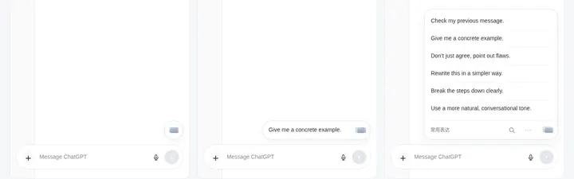

# Floating input — approved R3 source and visual reference

**PAIA-FLOAT-UI-1.3 / R3 / OWNER_APPROVED / 2026-10-18.** The owner accepted the delivered R3 with “可以，把这一版写进 github，修改开发计划”. Current choice: one shared skin, original quarter-circle as the board control corner, existing tools relocated to the bottom, no hover hints. The old source ID `PAIA-FLOAT-UI-1.2-R3` is preserved; canonical1.3 adopts the same bytes.

## Exact checked-in source

The full30-file [R3 source directory](design/narrow-input-board-v4/fusion-r3-2026-10-18/README.md) is incorporated byte-for-byte from PR299 commit `b807ebfb814bbcdbf3997039fd5c949d0fe1eff9`, subtree **`62dd8636f3325ed0a699d0d79983827fc37f9cda`**. It contains HTML/CSS/JS sources, nine SVGs, tokens, inheritance/review/integration records and reproducible checks. No rejected design replaces those files.

- [Interactive entry](design/narrow-input-board-v4/fusion-r3-2026-10-18/index.html) with adjacent sources; [build.py](design/narrow-input-board-v4/fusion-r3-2026-10-18/build.py) generates the self-contained HTML without external dependencies.
- [R3 tokens](design/narrow-input-board-v4/fusion-r3-2026-10-18/tokens.json), [fusion CSS](design/narrow-input-board-v4/fusion-r3-2026-10-18/fusion.css), [fusion layout](design/narrow-input-board-v4/fusion-r3-2026-10-18/fusion.js), [board skin](design/narrow-input-board-v4/fusion-r3-2026-10-18/assets/skin-board.svg) and exact card SVGs under assets govern appearance.
- [Original evidence manifest](design/narrow-input-board-v4/fusion-r3-2026-10-18/evidence/manifest.json), [prototype verification summary](design/narrow-input-board-v4/fusion-r3-2026-10-18/evidence/verification-summary.json) and [design decision](design/narrow-input-board-v4/fusion-r3-2026-10-18/REVIEW.md) retain their original evidence scope.

Frozen source README/token text saying independent, unmerged or not-canonical records the pre-approval delivery, not a competing present authority. This document and ADOPTION record its subsequent approval. Only R1 glyph/palette and other explicitly nonconflicting roles in tokens-r1 are inherited; old neck/board/tooltip values are not current tokens.

## Artifact identity and publication boundaries

[Adoption manifest](design/narrow-input-board-v4/adopted-r3-2026-10-18/manifest.json) records the source integrity check, deterministic rebuild and thumbnail derivation. All18 artifacts listed in the original source manifest were checked against the delivered ZIP's byte lengths and SHA256 values during adoption. The30 source files independently reproduced the selected Git subtree.

| Original delivered artifact | SHA256 |
|---|---|
| Self-contained HTML,59718 bytes | `fd8c886ad8e106b30adf096fe8cc3ec0357c493e207c5ec339239e9b2f949c22` |
| Light three-state PNG,1440×999 | `1acc39593b89426b2cdd801d643c6c9b6d5410d5a6182bb0e8522c72d0e62cdc` |
| Dark three-state PNG,1440×999 | `878e11b97ac2b5836024f6235b0cc1920f3642eeb8b84c2d9b6961361e0ba42f` |
| Fused-corner PNG,582×384 | `4463d0936adfa1a2f684ad7799d85ff8f4cc436709967b69bba2d704a353854e` |

The original generated HTML/PNGs/full reports remain identified conversation deliverables and reproducible outputs, **not falsely claimed stored as full binary originals in this repository**. The new checked-in light preview is a crop(0,400,1440,850), RGB, LANCZOS resize720×225, WebP quality78/method6;4444 bytes, SHA256 `7795e1ad48a3a696711535a89d08da23d86e2f2b791535e3d2ab6bf9c2e711a2`, blob `bf3f7f01948244a9dab9ca6af401a909f039ace5`. It is lossy/downscaled and serves navigation, not tiny-material or actual-size acceptance.

## Selected, historical and private scope

Selected: R3's complete shared corner and useful bottom toolbar, unchanged double cards/unified capsule, light/dark roles and no extra hints. Rejected A/C geometries, R2's separation, R1's neck, old B and earlier posters are history. They are not appearance options; do not reinterpret comparison-render scripts as a product theme picker.

The entire former references document remains byte-identical in [PRE_R3](NARROW_INPUT_BOARD_V4_REFERENCES_PRE_R3_2026-10-18.md), blob `b1cf021d8f3c9a4fc25ed83f0a82de6987b86ec0`, with its original image/hash and older history. It no longer controls the current shell pairing or toolbar position.

All published material is synthetic design context. No private Drive document, user archive, credentials, cookies, identifying conversation or actual account screenshot is added. The demonstration ChatGPT-like host is not a current-host specification. Do not copy host CSS/DOM, fixture ranking/data or textarea writes into production. Offline prototype checks, including the explicitly blocked direct-file probe, do not certify installed extension, real receiver/undo/privacy, physical120Hz, actual latency, OS IME/screen reader, provider quality or sustained comfort.
