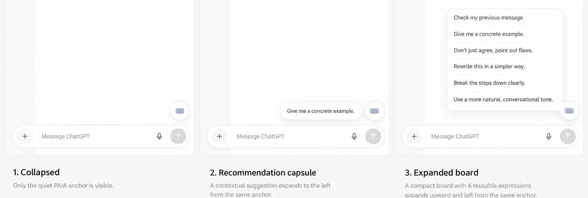

# Floating input — selected final double-card reference

**PAIA-FLOAT-UI-1.2 / OWNER_APPROVED / 2026-10-18.** The only current visual target is the **last** `PAIA_三态悬浮入口_最终精修.png` selected in the owner conversation. The instruction was “把这一版写进 github，修改开发计划”. Read [ADOPTION](NARROW_INPUT_BOARD_V4_ADOPTION.md), [SPEC](NARROW_INPUT_BOARD_V4_SPEC.md) and [PLAN](NARROW_INPUT_BOARD_V4_PLAN.md).

## 1. Checked-in component reference

The repository image is a faithful **cropped, downsampled, lossy WebP derivative** of the selected final PNG, not a new drawing and not the original PNG bytes. It preserves all three controls, the complete six-row board, their composer relationship and state captions. The irrelevant upper host page is omitted. Exact derivation and both file identities are recorded in [the manifest](PAIA_FLOAT_UI_1_2_REFERENCE_MANIFEST.json).

| Identity | Value |
|---|---|
| Selected original | `PAIA_三态悬浮入口_最终精修.png`,3072×2048,1454460bytes |
| Original SHA-256 | `dec1e0d19d373a0a6ae4219514bf9dc183f5ebe84773c8b7512f5ff96aa69c0e` |
| Checked-in derivative | `PAIA_FLOAT_UI_1_2_APPROVED_COMPONENTS.webp`,1536×520,21154bytes |
| Derivative SHA-256 | `fd0c56cba50817374fba40a60c1b24e9e5de72312d7e5daf9ac999ab41799293` |
| Derivative Git blob | `ab05f04b049e4f148070577a21010bdc68dc71cb` |
| Transformation | RGB; source crop left0/top900/right3072/bottom1940, right/bottom exclusive; LANCZOS resize1536×520; WebP quality75/method6 |

The original PNG remains the approved source, identified by its hash; this adoption does **not** claim that its full bytes are stored in GitHub. Do not relabel a resized/cropped file as the original. Small border/material details lost by compression are interpreted with the owner's explicit double-card constraints, not invented as exact design tokens. SPEC's CSS starting values are implementation calibration, not falsely measured source parameters.

## 2. Selected and superseded

Selected: fixed persistent white circular control; two equal horizontal, front-facing translucent gray-blue/slightly lavender cards; fixed foreground; high-overlap horizontal default; larger left-only offset in capsule; tiny upper-left offset in board; preserved capsule neck; refined lower-right board/circle junction. The circle's position and size are shared across states. Keep the approved quiet six-expression presentation and unchanged host context.

Not selected: B「句瓣」 solid quote/petal mark; diagonal or portrait double cards; the older glass-poster/lens/smoke explorations; intermediate generated showcase boards with colored row icons, arrows, technical insets, altered host composition or different button positions. Do not blend these into the final reference. No global PAIA rebrand or host redesign is authorized.

The complete preceding reference document is preserved byte-for-byte in [PRE_DOUBLE_CARD](NARROW_INPUT_BOARD_V4_REFERENCES_PRE_DOUBLE_CARD_2026-10-18.md), blob `56c3236f7cb08bc140a84e4f5f2a30e90d33192e`. Its original B prototype, SVGs, JSON, nine screenshots, hashes and earlier PRE_JUBAN/PRE_FIXED links remain historical evidence. Those exact B assets no longer control the new entry appearance or pairing. Their nonconflicting functional/domain evidence remains under ADOPTION's finite ledger.

## 3. Production and privacy boundary

This is a selected synthetic visual mockup, not a screenshot of an installed extension, a current authenticated ChatGPT session or a validated browser interaction. Its English expressions are sample text, not a dataset or a required production ranking. Reuse current real candidate, layout, private-frame, target and insertion owners. Do not copy host DOM, model/sidebar labels, mock data, global styling, sample controls or prototype textarea writers into production.

The checked-in crop contains only the necessary synthetic design surface; no private Drive document, real archive, account/profile, credentials, cookies or session material is published. Native-size light/dark fidelity, accessibility, actual insertion/privacy/undo, cold/warm latency, physical120Hz, sustained comfort and installation require their own evidence. The selected source is light mode only; dark adaptations are not already approved dark reference renders.
