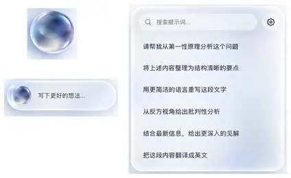

# Floating input — exact approved visual and retained behavior references

**PAIA-FLOAT-UI-1.0 / OWNER_APPROVED / 2026-10-16.** Product interpretation belongs to [SPEC](NARROW_INPUT_BOARD_V4_SPEC.md), not generated poster labels. Original V4 provenance, source mappings and evidence remain byte-identical in [PRE_FIXED](NARROW_INPUT_BOARD_V4_REFERENCES_PRE_FIXED_2026-10-16.md), blob `f060d414a0b8c47109a7a70b31e9d898efe9d935`. Old v4 six-state/adaptive material is historical comparison, not the final visual target.

## 1. Sole approved new visual

The owner selected the final generated sheet immediately before “可以，把这一版写进开发计划”, after the product review and “按照以上重新设计”. No other generated picture in the conversation is approved by that selection.

[View the checked-in sanitized component reference](design/narrow-input-board-v4/approved-2026-10-16/README.md). Its small sphere/capsule/panel crop is extracted from the exact original, not redrawn; source crop coordinates, resampling, byte count and hashes are recorded there. It contains no mock personal host sidebar and is a viewing aid, not a production screenshot or a substitute for the high-resolution original.

| Identity | Value |
|---|---|
| Original artifact | `a_clean_minimal_high_end_ui_ux_concept_poster_bo.png` |
| Original bytes | `1617064` |
| Original dimensions | `1536×1024` raster pixels; not CSS geometry |
| SHA-256 | `1aa39ae29f0a416163525ee8bfca2fb2edc03b19d84b26755752ce5e8499d698` |
| Owner-conversation artifact identifier | `file_0000000057588230964e8b4c557f8c27` |
| Visual status | Selected design approved; actual implementation fidelity not certified |

The original remains in the owner's conversation delivery. The identifier is provenance, not a public URL or guaranteed connector path. Do not copy the private Drive source, real accounts or personal mock-sidebar labels into the public repository. Recover the exact original through authorized attachment/Library handoff when a full-resolution comparison is needed; verify its hash before use. No filename-only substitution, recreated reference or invented sandbox/download URL.

Its selected features are smoky-blue/deep-indigo translucent depth in the sphere, a smaller related capsule cue, and a near-neutral frosted-white compact panel with single original-expression rows. The sheet is not a screenshot of an installed PAIA/ChatGPT account. Host labels/model branding, marketing scene layout, poster scale, gear appearance and capsule placeholder-like demo copy do not establish actual product controls.

## 2. Palette observations, not guessed optical parameters

Pixel samples from the five palette-circle centers in the original1536×1024 image:

| Position (x,y) | RGB / hex | Intended role |
|---|---|---|
| (1425,709) | (127,145,171) / `#7f91ab` | Smoky blue middle tone inside the sphere |
| (1425,754) | (39,58,95) / `#273a5f` | Localized deep-indigo depth, not a panel fill |
| (1425,799) | (138,143,184) / `#8a8fb8` | Restrained internal lavender transition |
| (1425,844) | (203,212,225) / `#cbd4e1` | Cool neutral transition/edge |
| (1425,889) | (246,247,248) / `#f6f7f8` | Near-neutral light material |

These are reproducible raster observations, not recovered CSS alpha/roughness/physical shader values or a new global PAIA theme. Preserve their relationship and the approved image rather than painting five opaque color sectors. Typography/readability, reduced-transparency and current dark/system roles remain authoritative. The panel must not inherit the sphere's saturated pattern.

## 3. Accepted V6 geometry/behavior, not its old sphere material

| Artifact | Bytes | SHA-256 |
|---|---:|---|
| `PAIA_悬浮输入_V6_交互原型.html` | 63779 | `f826a210e30e8a7cf0d587b0da432b675f81e4e925498cd196c966c3b21b78f6` |
| `PAIA_悬浮输入_V6_设计与实施规格.md` | 12119 | `3cb7872d8a77f29af72939c8bfb582bdd14d50fd775cbcd076a4cbed7ad7e92f` |

These original owner-delivery bytes were available and identity-checked during adoption. V6 supplies fixed336×312, six44px single-line rows, one-click eligible insertion, optional same-board detail/edit, unified150-character boundary, input avoidance and calm120/80ms motion. Its old glossy/concentric lens interpretation is superseded by the selected picture. Its proposed prototype narrow-layout constants do not mandate a second production position owner.

V6's specification reports111 historical local synthetic checks. This task did not rerun those checks; its standalone result JSON was not available in the current mounted files, so no fresh report/hash verification is claimed. Preserve the reported environment/limitations. The HTML's sample arrays, local memory, simulated text writer, review toolbar and fake host are not production architecture or proof of performance, security, native Mac/IME or live-provider behavior.

## 4. Review and handoff

Compare native40px orb plus enlarged material detail, native272×44 capsule and336×312 board, on unchanged light/dark/complex hosts. Only the orb carries appreciable colored depth. List rows are text-first and neutral; no eyes, send controls, categories, repeated spheres, title/subtitle or fabricated shortcut semantics. Avoid a new glossy-bead or white-pastel translation even if source and release match.

Use the exact approved original for final material fidelity; the checked-in crop plus SPEC/PLAN provide explicit behavior, geometry, color roles and owner mapping for independent safe implementation. A missing original blocks exact full-resolution fidelity claims only. Do not claim old v2/v4 material parity satisfies this later approval, or request repeated approval for an already selected direction. No runtime, formal logo change, website update, private source upload or installation follows from these references.